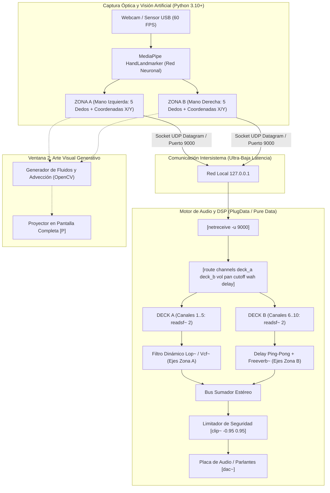

# CARPETA TÉCNICA Y ANTEPROYECTO: MESA SONORA
## Laboratorio de Sonido 3 — Trabajo Final Integrador

---

### DATOS GENERALES DEL PROYECTO
* **Título de la Obra:** *Mesa Sonora: Ecología Acústica y Sonomontaje Bimanual*
* **Formato Elegido:** Instalación Interactiva / Espacio Intervenido e Inmersivo
* **Eje Temático:** Morfología del paisaje sonoro, interacción bimanual y procesamiento digital de señal (DSP) en tiempo real mediante visión artificial.
* **Tecnologías Principales:**
  * Visión Computacional: Python 3 (`MediaPipe Tasks Vision` + `OpenCV`)
  * Protocolo de Comunicación: UDP (User Datagram Protocol) Socket local — Puerto `9000`
  * Motor de Audio y DSP: PlugData / Pure Data (`mesa_sonora.pd`)
  * Proyección Visual Generativa: Renderizado de fluidos y advección en Python (`NumPy` + `OpenCV`)

---

## 1. FUNDAMENTACIÓN CONCEPTUAL Y ESTÉTICA

A partir de las devoluciones de la cátedra respecto a la artificialidad de la emulación organológica tradicional, la propuesta abandonó la reproducción de instrumentos sintéticos para inscribirse de lleno en el territorio de la **Ecología Acústica (*Soundscape Ecology*)** y el **Sonomontaje Concreto**.

La instalación sitúa al interactor frente a una superficie reactiva donde la corporalidad no busca simular un teclado o una partitura académica, sino intervenir activamente sobre la materia sonora de un ecosistema vivo. Inspirada en los postulados de R. Murray Schafer y Pierre Schaeffer, la obra descompone un entorno biofónico y geofónico (viento, corriente fluvial, fauna nocturna, aves y follaje vegetal) en estratos acústicos independientes.

### Tensión Bimanual (Deck A / Deck B):
La experiencia se fundamenta en un principio de **control asimétrico y dialógico**:
1. **Mano Izquierda (Deck A — Zona de Montaje y Densidad):** Activa y articula la presencia temporal de los estratos naturales mediante gestos discretos de los dedos, mientras su traslación espacial modula la respuesta en frecuencia (brillo, distancia y profundidad subacuática a través de filtros pasa-bajos dinámicos).
2. **Mano Derecha (Deck B — Zona de Espacialización y Memoria):** Permite disparar réplicas paralelas del mismo banco tímbrico para generar un **canon textural**, mientras su posición en el espacio modula reflexiones acústicas (retardos ping-pong y reverberación), desdoblando la fuente puntual hacia una resonancia arquitectónica o cavernosa.

El resultado es una obra donde el usuario no "ejecuta notas", sino que esculpe y transforma el paisaje en tiempo real, diluyendo la frontera entre naturaleza y procesamiento electroacústico.

---

## 2. ESTADO DEL ARTE Y REFERENCIAS (FICHAS ANALÍTICAS)

> *Nota reglamentaria: Se presentan tres antecedentes directrices debidamente analizados conforme a la consigna de la cátedra.*

### FICHA ANALÍTICA 1: R. Murray Schafer — *The Soundscape: Our Sonic Environment and the Tuning of the World* (1977)
* **Disciplina / Campo:** Ecología Acústica y Filosofía del Sonido.
* **Conceptos Clave:** *Keynote Sounds* (tonos fundamentales), *Sound Signals* (señales sonoras) y *Soundmarks* (marcas sonoras). Distinción entre paisajes *Hi-Fi* (alta fidelidad acústica, donde cada evento se percibe con claridad sin enmascaramiento) y *Lo-Fi* (saturación y ruido continuo).
* **Relevancia Directriz en la Propuesta:**  
  La selección de las 5 capas del proyecto (viento abisal en los árboles, corriente de río, pasos sobre hojas y ramas, canto de aves y trueno con lluvia) responde rigurosamente a la taxonomía de Schafer. El sistema evita la acumulación ruidosa (*Lo-Fi*) mediante la asignación de bandas espectrales diferenciadas y rampas de ganancia compensadas, permitiendo que el interactor construya un paisaje *Hi-Fi* transparente donde cada estrato conserva su identidad acústica.

---

### FICHA ANALÍTICA 2: Sergi Jordà, Günter Geiger, Marcos Alonso y Martin Kaltenbrunner — *The Reactable* (Grupo de Tecnología Musical, Universitat Pompeu Fabra, 2005-2007)
* **Disciplina / Campo:** Nueva Interfaz para la Expresión Musical (NIME) / Mesa Tangible Multiusuario.
* **Aspectos Técnicos:** Detección óptica mediante cámara infrarroja bajo mesa de acrílico translúcido (*reacTIVision*), seguimiento de fiduciales y síntesis modular en tiempo real con Pure Data.
* **Relevancia Directriz en la Propuesta:**  
  *The Reactable* constituye el antecedente técnico-estructural directo de nuestra *Mesa Sonora*. Se toma de esta obra el paradigma de interacción sobre una superficie compartida donde la posición física de los elementos altera de forma continua los parámetros de DSP (filtros y retardos) y donde la retroalimentación visual generativa (fluidos luminiscentes en nuestra propuesta) informa al espectador sobre el flujo de la energía sonora sin recurrir a interfaces numéricas tradicionales.

---

### FICHA ANALÍTICA 3: Pierre Schaeffer y Michel Chion — *Traité des Objets Musicaux* (1966) / La Escucha Acusmática
* **Disciplina / Campo:** Música Concreta, Electroacústica y Fenomenología Sonora.
* **Conceptos Clave:** Objeto Sonoro (*Objet Sonore*), escucha reducida (desligar el sonido de su causa física originaria) y morfología sonora (criterios de grano, masa y perfil temporal).
* **Relevancia Directriz en la Propuesta:**  
  La mesa opera como un laboratorio de escucha reducida. Al alterar el pitch, desacelerar la velocidad temporal o sumergir el sonido del río y el viento en filtros resonantes mediante el desplazamiento gestual de las manos, el sonido extraído de la naturaleza deja de ser un mero registro documental (*field recording*) para transformarse en materia plástica, permitiendo al público percibir texturas espectrales insospechadas.

---

## 3. ARQUITECTURA DE SISTEMA Y PROTOCOLOS



### Especificación Formal de Mensajes UDP (Puerto 9000):
| Mensaje | Formato de Carga Útil | Frecuencia | Función en PlugData |
| :--- | :--- | :--- | :--- |
| `channels` | `c1 c2 c3 c4 c5 c6 c7 c8 c9 c10` (bits 0/1) | Por evento / 400 ms | Dispara y frena con rampa `line~ 160ms` cada reproductor. |
| `deck_a` | `x y` (flotantes normalizados 0.0 - 1.0) | 25 Hz continuo | $X$ barre corte `lop~` (60 Hz - 15 kHz); $Y$ modula formante `vcf~` (220 Hz - 3.5 kHz, Q=7.0). |
| `deck_b` | `x y` (flotantes normalizados 0.0 - 1.0) | 25 Hz continuo | $X$ modula envío a `delread~` estéreo; $Y$ modula espacialidad. |
| `vol` | `v` (flotante 0.0 - 1.2) | 25 Hz continuo | Nivel maestro con curva adaptativa antirruido. |
| `pan` | `p` (flotante 0.0 - 1.0) | 25 Hz continuo | Distribución espacial de la mezcla estéreo. |

---

## 4. CONTRATO DE ROLES DEL EQUIPO DE TRABAJO

| Integrante | Rol Asignado | Responsabilidades Principales |
| :--- | :--- | :--- |
| **Integrante 1** | **Especialista DSP y Audio (PlugData)** | Programación de los bancos de lectura `[readsf~ 2]`, diseño del rack de filtros `[lop~]` y `[vcf~]`, ecos cruzados `[delwrite~]`, ruteo UDP y calibración de curvas de ganancia anti-saturación. |
| **Integrante 2** | **Ingeniero de Visión y Telemetría (Python)** | Implementación de `MediaPipe HandLandmarker`, cálculo biomecánico de apertura y flexión de los 10 dedos, normalización por zonas espaciales (Zona A y B) y transmisión UDP socket. |
| **Integrante 3** | **Diseñador Sonoro y Curador de Audio** | Grabación en campo y edición de muestras acústicas (`44.1 kHz / 16-bit WAV`), limpieza espectral de ruidos parásitos, normalización de sonoridad (*LUFS*) y diseño del guion dramático. |
| **Integrante 4** | **Director de Puesta en Escena y Documentación** | Calibración lumínica de la mesa, configuración de la 2da ventana de proyección líquida, montaje físico de la cámara cenital, redacción de la bitácora online y producción del registro audiovisual. |

---

## 5. GUION DE EXPERIENCIA DE USUARIO (DIAGRAMA DE INTERACCIÓN)

```
[MOMENTO 0: ESPERA / LATENCIA]
  * La mesa proyecta un flujo fluido en reposo.
  * Pure Data permanece en silencio con DSP activo.
      |
[MOMENTO 1: ACERCAMIENTO]
  * El usuario coloca sus manos sobre el campo visual de la cámara.
  * El monitor de control detecta los 42 puntos articulares y traza las zonas A y B.
      |
[MOMENTO 2: INTRODUCCIÓN DEL PAISAJE (Mano Izquierda)]
  * Al levantar dedos de la mano izquierda, ingresan las capas base (viento, río).
  * El movimiento horizontal (Eje X) "ilumina" el sonido barriendo las frecuencias agudas.
      |
[MOMENTO 3: DIÁLOGO Y CANON TEXTURAL (Mano Derecha)]
  * Al ingresar la mano derecha en la Zona B, levanta dedos idénticos o complementarios.
  * Se genera una polifonía espacial: la mano derecha aleja los sonidos en ecos reverberantes.
      |
[MOMENTO 4: CLÍMAX Y TRANSFORMACIÓN]
  * Ambas manos interactúan en posiciones extremas (brazos abiertos o alturas contrastadas).
  * El paisaje natural se transforma en una masa abstracta electroacústica inmersiva.
      |
[MOMENTO 5: RESOLUCIÓN]
  * Las manos se retiran o cierran en puño; los atenuadores lineales (`line~`) disuelven el audio suavemente.
```

---

## 6. ESPECIFICACIÓN DE ENTREGABLES FINALES (ETAPA 3)

1. **Bitácora Online:** Documentación viva del proceso de investigación, cronología de cambios (transición desde la orquesta sintética hacia el sonomontaje de campo) y soluciones técnicas adoptadas.
2. **Video Trailer (Exhibición):** Pieza audiovisual de 1:30 a 2:00 minutos que sintetiza la atmósfera de la obra, la interacción corporal y el impacto de la proyección inmersiva en penumbras.
3. **Video Técnico (Desglose):** Explicación pedagógica paso a paso:
   * Demostración de la independencia entre Python (cero audio) y PlugData (cero visión).
   * Monitoreo de paquetes UDP en consola y comportamiento del patch de Pure Data.
   * Demostración en vivo de los efectos (barrido de filtro, modulación de delay y canon de capas).
4. **Exhibición en Vivo:** Montaje de la cámara sobre estructura cenital o trípode estable, superficie de control despejada, proyección activa y salida de audio estéreo calibrada para el aula de clase.
