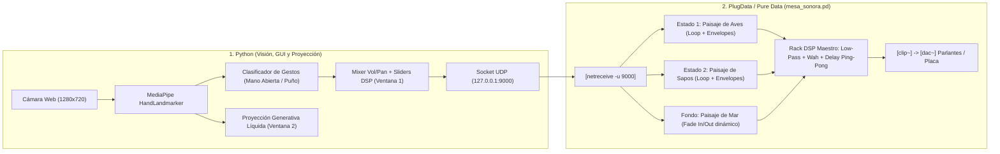

# Mesa Sonora: Control Gestual de 2 Estados + Mixer Vol/Pan + Filtros DSP
**Laboratorio de Sonido 3 — Trabajo Final Integrador: Sonomontaje y Ecología Acústica**

Sistema interactivo de sonomontaje y procesamiento de audio en tiempo real mediante visión artificial por cámara web, comunicación UDP local y síntesis/DSP en **PlugData / Pure Data**.

---

## 1. Arquitectura del Sistema



---

## 2. Estructura de Archivos

* **`iniciar.bat`**: Lanzador por doble clic que ejecuta Python e inicia PlugData automáticamente con el patch cargado.
* **`mesa_sonora.py`**: Aplicación central en Python (captura de cámara, seguimiento con MediaPipe, interfaz de usuario con OpenCV y simulación de fluidos).
* **`mesa_sonora.pd`**: Patch modular de PlugData / Pure Data con recepción UDP, ruteo de señales, envolventes antirruido y rack de efectos DSP.
* **`hand_landmarker.task`**: Modelo de red neuronal de MediaPipe optimizado para detección y tracking de puntos clave de la mano.
* **`sonidos/`**: Banco de audios estéreo en formato `.wav`:
  * `paisaje-de-aves.wav`: **Estado 1 (Mano Abierta)** — Biofonía diurna, texturas vivaces y agudas. (Vol: 135%, Pan: Centro).
  * `paisaje-de-sapos.wav`: **Estado 2 (Puño Cerrado)** — Biofonía nocturna, frecuencias medias-bajas rítmicas. (Vol: 160%, Pan: Centro).
  * `paisaje-de-mar.wav`: **Pista base constante** — Geofonía envolvente. Fade-In al interactuar, 10s de cola tras retirar la mano y Fade-Out gradual. (Vol: 35%, Pan: Centro).
* **`diagramas/`**:
  * `diagrama_1_python.png`: Diagrama de flujo de visión artificial, interfaz gráfica y proyección.
  * `diagrama_2_plugdata.png`: Diagrama de ruteo de audio, canales y DSP en PlugData.

---

## 3. Paneles de la Interfaz (Ventana 1: Trackeo)

### Panel Izquierdo: Mezclador en Vivo
* **Volumen (0% a 200%)**: Sliders independientes para Aves, Sapos y Mar.
* **Paneo (L100% - C - R100%)**: Ubicación estéreo independiente para cada paisaje sonoro.

### Panel Derecho: Filtros y Procesamiento DSP
* **Low-Pass (120 Hz a 15 kHz)**: Filtro pasa-bajos de doble polo (-12 dB/oct). En frecuencias bajas produce un efecto subacuático/cavernoso; abierto restaura todo el brillo espectral.
* **Wah Resonante (Mix 0-100% | Frecuencia 180 Hz a 3.8 kHz | $Q = 9.0$)**: Barrido resonante muy pronunciado con formante vocal dinámico ("ooo" a "iii").
* **Delay Ping-Pong (Wet 0-100% | Feedback 0-88%)**: Retardo estéreo cruzado (320 ms izquierda / 460 ms derecha) que va desde un rebote sutil hasta ecos cavernosos infinitos.

---

## 4. ¿Cómo funcionan los Filtros y Efectos? (Explicación Sencilla y Valores del Patch)

Los filtros y efectos DSP (*Digital Signal Processing*) transforman el sonido de las **Aves** y los **Sapos** en tiempo real dentro de `mesa_sonora.pd`. A continuación se explica de forma simple qué hace cada uno, qué valores exactos maneja este patch y cómo regularlos para lograr **menos o más intensidad**:

### Resumen rápido de valores del patch (`mesa_sonora.pd` / `mesa_sonora.py`)

| Efecto / Objeto PD | Parámetro (Slider / UDP) | Rango en Interfaz | Valor Inicial | Valores internos en PlugData | Modo Mano |
| :--- | :--- | :--- | :--- | :--- | :--- |
| **Low-Pass** (`[lop~]` × 2) | `CORTE` (`in_cutoff`) | `120 Hz` – `15 kHz` (log) | `15 kHz` (`OPEN`) | Doble polo `-12 dB/oct` (`50–15000 Hz`) | **`[F]`** Eje X |
| **Wah Resonante** (`[vcf~]`) | `MIX` (`in_wah` #1) | `0%` – `100%` | `0%` (`OFF`) | Dry `1.0 → 0.25` / Wet `0.0 → 3.5` (`line~ 40 ms`) | **`[W]`** Fijo `85%` |
| **Wah Resonante** (`[vcf~]`) | `FREQ` (`in_wah` #2) | `180 Hz` – `3.8 kHz` (log) | `900 Hz` | Resonancia fija **`Q = 9.0`** (`line~ 40 ms`) | **`[W]`** Eje Y |
| **Delay Ping-Pong** (`[delread~]`) | `NIVEL` (`in_delay`) | `0%` – `100%` | `0%` (`OFF`) | Ganancia Wet `0.0 → 1.25` (`line~ 50 ms`) | **`[E]`** Eje Z |
| **Delay Ping-Pong** (`[delwrite~]`) | `REPET` (`in_delay_fb`) | `0%` – `88%` | `72%` (`0.72`) | Retardo `320 ms` (L) / `460 ms` (R), feedback máx. `0.88` | Slider manual |

---

### 1. Low-Pass — Filtro Pasa-Bajos (`[lop~]` doble polo)
* **¿Qué hace?** Deja pasar los sonidos **graves** y va recortando los **agudos** (por eso se llama "pasa-bajos").
* **¿Cómo suena?** Como escuchar música **debajo del agua** o **detrás de una pared**. Usa dos filtros `[lop~]` encadenados en serie (`lop~ -> lop~`) por canal (`-12 dB/oct`), lo que hace que el recorte se note mucho al moverlo.
* **Valores en este patch:** Rango de **`120 Hz` a `15.000 Hz` (`15 kHz`)** en escala logarítmica. Arranca en **`15 kHz` (`OPEN`)**, totalmente transparente.
* **Cómo regular la intensidad:**
  * **Sin efecto / natural:** `10 kHz` – `15 kHz` (`OPEN`, por encima de `14.5 kHz` queda abierto).
  * **Intensidad media (cálido / velado):** `800 Hz` – `2.5 kHz` (suaviza los agudos de las aves sin apagar la escena).
  * **Máxima intensidad (sumergido / cavernoso):** `120 Hz` – `400 Hz` (corta casi todos los agudos y medios, dejando solo graves).
* **Control por mano (`[F]`):** Eje horizontal **X** — mover a la **izquierda** baja la frecuencia (más oscuro/intenso); mover a la **derecha** abre el filtro (más brillante/natural).

### 2. Wah Resonante — Filtro Pasa-Banda (`[vcf~]` con $Q = 9.0$)
* **¿Qué hace?** En lugar de cortar solo graves o agudos, elige una franja angosta de frecuencias y la **resalta con mucha fuerza** (resonancia fija **`Q = 9.0`**).
* **¿Cómo suena?** Igual que el pedal **Wah-Wah** de una guitarra eléctrica o como cuando movés la boca diciendo **"ooo – aaa – iii"**.
* **Valores en este patch:**
  * **`MIX`** (`0%` a `100%`, arranca en **`0%` / `OFF`**): mezcla la señal original (*Dry*, que baja de `1.0` a `0.25`) con la señal filtrada amplificada (*Wet*, que sube de `0.0` hasta **`×3.5`**), todo suavizado con `[line~]` de `40 ms` para evitar clics.
  * **`FREQ`** (`180 Hz` a `3.800 Hz`, arranca en **`900 Hz`**): desplaza el pico vocal desde grave cerrado (`Ooo`) hasta agudo filoso (`Iii`).
* **Cómo regular la intensidad:**
  * **Apagado / sutil:** `MIX` en **`0%`** (`OFF`), o entre **`15% – 35%`** para dar apenas un color resonante sobre el sonido original.
  * **Intensidad media:** `MIX` entre **`40% – 70%`** moviendo **`FREQ`** suavemente alrededor de `500 Hz – 1.8 kHz`.
  * **Máxima intensidad (efecto vocal/metálico marcado):** `MIX` entre **`80% – 100%`** y barrer **`FREQ`** de punta a punta (`180 Hz` "Ooo" ↔ `900 Hz` "Aaa" ↔ `3.8 kHz` "Iii").
* **Control por mano (`[W]`):** Activa automáticamente **`MIX = 85%`** y usa la **altura de la mano (eje Y)** para mover **`FREQ`** (mano **abajo** = `180 Hz` "Ooo"; mano **arriba** = `3.8 kHz` "Iii").

### 3. Delay Ping-Pong — Eco Estéreo (`[delwrite~]` / `[delread~]`)
* **¿Qué hace?** Graba un fragmento del sonido en una memoria temporal de `1000 ms` y lo repite instantes después, haciendo que el **eco rebote de izquierda a derecha** como una pelotita de ping-pong.
* **¿Cómo suena?** Convierte un sonido seco y cercano en un espacio amplio, como una **cueva o un valle**, con rebotes estéreo asimétricos (**`320 ms`** en el parlante izquierdo y **`460 ms`** en el derecho) realimentados de forma cruzada (`L → R` y `R → L`).
* **Valores en este patch:**
  * **`NIVEL`** (`0%` a `100%`, arranca en **`0%` / `OFF`**): volumen del eco (*Wet*). Al enviarse a PlugData se escala hasta **`1.25`** (con `[line~]` de `50 ms`) para que al `100%` el rebote sea bien protagonista.
  * **`REPET`** (`0%` a `88%`, arranca en **`72%` / `0.72`**): cantidad de repeticiones (*Feedback*). Tiene un tope seguro en **`0.88`** para lograr colas muy largas sin que sature ni acople.
* **Cómo regular la intensidad:**
  * **Sin eco:** **`NIVEL` en `0%`** (`OFF`). *(Aunque `REPET` arranque en `72%`, no hay eco hasta subir `NIVEL`.)*
  * **Intensidad baja (ambiente / sala chica):** `NIVEL` entre **`20% – 40%`** y `REPET` entre **`25% – 45%`** (1 o 2 rebotes cortos).
  * **Intensidad media (espacio amplio):** `NIVEL` entre **`50% – 75%`** y `REPET` entre **`60% – 75%`** (zona del valor por defecto `72%`).
  * **Máxima intensidad (cueva / ecos casi infinitos):** `NIVEL` entre **`80% – 100%`** y `REPET` entre **`80% – 88%`** (rebotes muy presentes y prolongados entre ambos oídos).
* **Control por mano (`[E]`):** Usa la **cercanía de la mano a la cámara (eje Z)** para controlar **`NIVEL`** de `0%` a `100%` (mano **lejos** = menos eco; mano **cerca** = más eco), conservando la cantidad de repeticiones elegida en **`REPET`**.

### ¿En qué orden pasa el sonido? (Cadena DSP)
El audio recorre los módulos siempre en este orden:
1. **Aves y Sapos** entran al **Low-Pass** (define cuánto brillo/agudos pasan).
2. Esa señal pasa al **Wah Resonante** (le suma el barrido vocal "ooo – iii").
3. Luego entra al **Delay Ping-Pong** (hace rebotar el sonido ya filtrado entre ambos parlantes).
4. Al final se suma el **Paisaje de Mar** (que se mantiene limpio de fondo para sostener la atmósfera) y todo atraviesa un **limitador de seguridad (`[clip~ -0.95 0.95]`)** antes de salir a los parlantes (`[dac~]`), evitando distorsión incluso con los efectos al máximo.

> **Tips de control y visuales:**
> * **Clic derecho** sobre cualquier slider lo devuelve a su valor inicial; **`[R]`** resetea todo de una vez.
> * Si movés un slider con el mouse mientras ese efecto estaba en modo mano (`[F]/[W]/[E]`), pasa automáticamente a modo manual para que no peleen entre sí.
> * Los filtros también modifican la proyección líquida en vivo: abrir el **Low-Pass** acelera el fluido y subir el **Delay** deja estelas visuales más largas en pantalla.

---

## 5. Guía de Controles (Mouse y Teclado)

| Control | Acción | Descripción |
| :--- | :--- | :--- |
| **Mouse Izquierdo** | Clic y arrastrar | Mover sliders de Volumen, Pan o DSP en tiempo real |
| **Mouse Derecho** | Clic sobre un slider | Resetear ese slider individual a su valor predeterminado |
| **`[R]`** | Teclado | **Reset total**: restablece todos los sliders y apaga/abre filtros DSP |
| **`[F]`** | Teclado | Alternar Low-Pass entre **Slider manual** vs **Control por Mano (Eje X)** |
| **`[W]`** | Teclado | Alternar Wah entre **Slider manual** vs **Control por Mano (Eje Y)** |
| **`[E]`** | Teclado | Alternar Delay entre **Slider manual** vs **Control por Mano (Profundidad Z)** |
| **`[F11]` / `[P]`** | Teclado | **Pantalla Completa** en la ventana de Proyección Líquida |
| **`[V]`** | Teclado | Cambiar **Estilo Visual** (1: Tinta líquida, 2: Plasma orgánico, 3: Ferrofluido) |
| **`[S]`** | Teclado | Activar/desactivar **Silueta difusa** de manos (vidrio esmerilado / sombra sumergida) |
| **`[+]` / `[-]`** | Teclado | Aumentar o disminuir escala de la mano proyectada en vivo ($\pm 10\%$) |
| **`[` / `]`** | Teclado | Disminuir o aumentar el factor de suavizado del trackeo ($\pm 0.05$) |
| **`[M]`** | Teclado | Disparar Fade-In / Fade-Out manual del Paisaje de Mar |
| **`[C]`** | Teclado | **Silenciar todo** en Pure Data y limpiar lienzo visual |
| **`[Q]` / `[ESC]`** | Teclado | Salir de la aplicación y cerrar sesión limpiamente |

---

## 6. Parámetros de Línea de Comandos

```bash
python mesa_sonora.py [--cam CAM] [--port PORT] [--host HOST] [--smooth SMOOTH] [--margin MARGIN] [--no-pd]
```

* `--cam`: Índice de cámara web (por defecto: `0`).
* `--port`: Puerto UDP de destino en PlugData (por defecto: `9000`).
* `--host`: Dirección IP de recepción (por defecto: `127.0.0.1`).
* `--smooth`: Factor de suavizado EMA inicial entre 0.0 y 0.95 (por defecto: `0.70`).
* `--margin`: Margen activo en los bordes de cámara (por defecto: `0.08`).
* `--model`: Ruta personalizada al archivo `hand_landmarker.task`.
* `--no-pd`: No intentar abrir PlugData automáticamente.

---

## 7. Requisitos de Instalación

1. **Python 3.9 o superior** con las siguientes dependencias:
   ```bash
   pip install opencv-python mediapipe numpy
   ```
2. **PlugData** (recomendado: [plugdata.org](https://plugdata.org)) o **Pure Data Vanilla** con soporte para `[netreceive]`.
