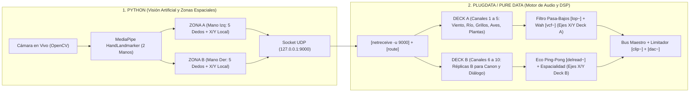

# Mesa Sonora: Sonomontaje y Paisaje Sonoro Bimanual (Doble Deck A/B en PlugData)

**Asignatura:** Laboratorio de Sonido 3 / Diseño Sonoro  
**Proyecto:** Consola de Sonomontaje y Manipulación Espacial de Paisaje Sonoro (10 Canales en PlugData / Doble Deck)  
**Arquitectura:** Visión Artificial en Python (`MediaPipe` + `OpenCV`) $\rightarrow$ Protocolo `UDP` (Puerto 9000) $\rightarrow$ Motor de Audio y DSP 100% en **PlugData / Pure Data** (`mesa_sonora.pd`)

---

## 1. Arquitectura General (Separación Visión vs. Sonido)

* **Python ([`mesa_sonora.py`](file:///c:/Users/Notebook%20Store/Downloads/mesa_sonora_sonomontaje-10/mesa_sonora_sonomontaje-10/mesa_sonora.py)):** **NO reproduce audio**. Se dedica exclusivamente a leer la biomecánica de **ambas manos**, dividir la mesa en dos zonas activas (**Deck A** izquierda y **Deck B** derecha) y enviar telemetría de baja latencia por red local UDP.
* **PlugData ([`mesa_sonora.pd`](file:///c:/Users/Notebook%20Store/Downloads/mesa_sonora_sonomontaje-10/mesa_sonora_sonomontaje-10/mesa_sonora.pd)):** **Es el único motor sonoro**. Lee directamente desde el disco los archivos `.wav` de grabaciones reales de campo en `sonidos/`, los reproduce en bucle continuo con *fade* suave y los procesa mediante filtros y efectos acústicos en tiempo real.

---

## 2. Mapeo de las Capas del Paisaje Sonoro (Doble Deck A/B)

### Deck A — Mano Izquierda (Canales 1 a 5 en PlugData)
* **Control Gestual:** Dedos activan capas | Posición $(X_A, Y_A)$: $X$ modula el Filtro Pasa-Bajos ($180 - 14.000\text{ Hz}$), $Y$ modula el Tono/Resonancia.

| Canal PD | Dedo de la Mano Izquierda | Elemento del Paisaje Sonoro | Archivo `.wav` leído por PlugData | Tecla WAV |
| :---: | :--- | :--- | :--- | :---: |
| **1** | **Meñique Izquierdo** | Viento en los Árboles (Cama base) | `sonidos/1_viento_arboles.wav` | `[1]` |
| **2** | **Anular Izquierdo** | Agua de Río (Textura continua) | `sonidos/2_agua_rio.wav` | `[2]` |
| **3** | **Mayor Izquierdo** | Pasos en el Bosque (Crujidos foley) | `sonidos/3_pasos.wav` | `[3]` |
| **4** | **Índice Izquierdo** | Canto de Aves (Eventos vivos y dinámicos) | `sonidos/4_aves.wav` | `[4]` |
| **5** | **Gordo (Pulgar) Izquierdo** | Trueno y Lluvia (Fuerza y clímax) | `sonidos/5_trueno_lluvia.wav` | `[5]` |

### Deck B — Mano Derecha (Canales 6 a 10 en PlugData)
* **Control Gestual:** Dedos activan capas en paralelo | Posición $(X_B, Y_B)$: $X$ modula el Eco Ping-Pong ($0 - 65\%$), $Y$ modula el Espacio y Profundidad.

| Canal PD | Dedo de la Mano Derecha | Elemento del Paisaje Sonoro | Archivo `.wav` leído por PlugData | Tecla WAV |
| :---: | :--- | :--- | :--- | :---: |
| **6** | **Gordo (Pulgar) Derecho** | Trueno y Lluvia (Copia Deck B) | `sonidos/5_trueno_lluvia.wav` | `[6]` |
| **7** | **Índice Derecho** | Canto de Aves (Copia Deck B) | `sonidos/4_aves.wav` | `[7]` |
| **8** | **Mayor Derecho** | Pasos en el Bosque (Copia Deck B) | `sonidos/3_pasos.wav` | `[8]` |
| **9** | **Anular Derecho** | Agua de Río (Copia Deck B) | `sonidos/2_agua_rio.wav` | `[9]` |
| **10** | **Meñique Derecho** | Viento en los Árboles (Copia Deck B) | `sonidos/1_viento_arboles.wav` | `[0]` |

> **Canon y Diálogo Espacial:** Al disparar un mismo sonido con ambas manos (por ejemplo, el agua del río con el anular izquierdo y el anular derecho), cada mano lo procesa con una física diferente: la izquierda puede sumergirlo en frecuencias graves y oscuras, mientras la derecha lo espacializa con ecos brillantes en el oído opuesto.

---

## 3. Explicación Paso a Paso del Patch de PlugData (`mesa_sonora.pd`)

El patch fue organizado con **flujo vertical de arriba hacia abajo** en 4 columnas prolijas y comentadas al lado de cada etapa para poder explicarlo en clase:

### A) Cabecera y Recepción de Red (`Columna 1 Superior`)
1. **`[loadbang]` $\rightarrow$ `[; pd dsp 1(`**: Al abrir el patch, envía automáticamente la orden interna a Pure Data/PlugData para encender el procesamiento digital de señal (`DSP ON`).
2. **`[netreceive -u 9000]`**: Abre un puerto receptor UDP en el número `9000` que escucha los paquetes enviados desde Python a 30-60 FPS.
3. **`[route channels load vol pan cutoff wah delay ...]`**: Clasifica cada mensaje según su primera palabra clave y lo envía por su salida correspondiente hacia transmisores inalámbricos **`[s in_...]`** (*send*), evitando cruzar cables por toda la pantalla.

### B) Módulos de los 10 Canales de Audio (`Columnas 2 y 3: ch_1 a ch_10`)
Cada uno de los 10 instrumentos tiene su propio módulo reproductor con flujo vertical:
1. **`[r ch_N]` $\rightarrow$ `[change]` $\rightarrow$ `[tgl]`**: Recibe `1` (dedo levantado) o `0` (dedo cerrado). El objeto `[change]` filtra números repetidos para disparar la orden solo cuando el dedo cambia de estado.
2. **Envolvente Antirruido (`[pack f 160]` $\rightarrow$ `[line~]` $\rightarrow$ `[*~]`)**: Cuando el canal pasa a `1` o a `0`, genera una rampa continua de **160 milisegundos** (*fade-in* / *fade-out*) que multiplica el audio estereofónico en `[*~]`. Esto evita clics digitales al activar o silenciar instrumentos.
3. **Lectura desde Disco (`[sel 1 0]` $\rightarrow$ `[symbol sonidos/N_archivo.wav]` $\rightarrow$ `[t b s]` $\rightarrow$ `[open $1(` + `[1(` $\rightarrow$ `[readsf~ 2]`)**:
   * En Pure Data, `[readsf~ 2]` necesita **primero** abrir el archivo (`open ruta.wav`) y **luego** recibir un `1` para empezar a reproducir.
   * El objeto **`[t b s]`** (*trigger bang symbol*, que ejecuta de derecha a izquierda) garantiza ese orden exacto: primero envía el nombre del archivo (`s`) al mensaje `[open $1(` y un instante lógico después envía el `bang` (`b`) al mensaje `[1(`.
4. **Bucle Infinito (*Loop*) con `[spigot]`**:
   * El 3er *outlet* (salida derecha) de `[readsf~ 2]` emite un `bang` justo cuando el archivo `.wav` llega al final.
   * Ese `bang` entra a `[spigot]` (una compuerta que permanece abierta mientras el *toggle* del canal esté en `1`) y vuelve a disparar `[symbol sonidos/...]` para reabrir y reproducir el `.wav` sin cortes.
5. **Envío al Bus de Mezcla (`[throw~ mix_L]` y `[throw~ mix_R]`)**: Envía la señal estéreo del canal hacia el bus sumador maestro.

### C) Rack Maestro de Filtros y Efectos DSP (`Columna 4: Flujo Vertical`)
1. **Bus Sumador (`[catch~ mix_L]` y `[catch~ mix_R]`)**: Recibe y suma en tiempo real la señal de los 10 canales `[throw~]`.
2. **Etapa A — Filtro Pasa-Bajos `[lop~ 12000]` (Fuelle Bimanual)**:
   * Controlado por la **distancia entre ambas manos** (`r in_cutoff`).
   * Con las manos juntas la frecuencia de corte baja a `240 Hz` (sonido cálido, íntimo y velado); al separar los brazos como un director de orquesta, el filtro se abre exponencialmente hasta `12.000 Hz` liberando todos los armónicos agudos del clavecín, violines y vientos.
3. **Etapa B — Filtro Resonante / Wah `[vcf~ 800 3.5]`**:
   * Filtro pasa-banda controlado por voltaje con resonancia $Q = 3.5$.
   * La altura $Y$ de la **Mano Derecha** barre la frecuencia central entre `300 Hz` y `2.600 Hz`, resaltando los formantes acústicos de las cuerdas y maderas, y se suma en paralelo (`[+~]`) a la señal principal.
4. **Etapa C — Eco / Delay Estéreo Ping-Pong (`[delwrite~]` / `[delread~]`)**:
   * Dos memorias de retardo de 1000 ms (`[delwrite~ eco_l 1000]` y `[delwrite~ eco_r 1000]`) son leídas con tiempos distintos en cada oído: **`320 ms` a la izquierda** y **`460 ms` a la derecha**.
   * Sus salidas atenuadas (`[*~ 0.42]`) se realimentan de forma cruzada (`L` hacia `R` y `R` hacia `L`), creando la espacialidad reverberante de una sala o iglesia barroca según la cercanía $Z$ de las manos a la cámara.
5. **Etapa D — Paneo Estéreo, Volumen Master, `[clip~]` y `[dac~]`**:
   * Distribuye la imagen estéreo (`in_pan`), regula el nivel general (`in_vol`) con la altura $Y$ de la Mano Izquierda, protege contra saturación mediante `[clip~ -0.95 0.95]` y entrega el audio final a la placa de sonido en **`[dac~]`**.

---

## 4. Librerías de Python Utilizadas

| Librería | Rol dentro del Proyecto |
| :--- | :--- |
| **`mediapipe`** (`mediapipe.tasks.python.vision`) | Ejecuta la red neuronal *HandLandmarker* de Google que detecta hasta **2 manos simultáneas** y obtiene las coordenadas 3D $(x, y, z)$ de los **21 puntos articulares (*landmarks*)** de cada mano (42 puntos en total). |
| **`cv2` (`opencv-python`)** | Captura el video de la cámara en tiempo real (`CAP_DSHOW`), aplica el espejo horizontal (`cv2.flip`) y dibuja toda la interfaz gráfica (esqueleto de ambas manos, puente bimanual y paneles de los 10 instrumentos). |
| **`numpy`** | En [`generar_sonidos.py`](file:///c:/Users/dedic/Desktop/sonido/final-sonido/entrega/mesa_sonora_sonomontaje/generar_sonidos.py) sintetiza matemáticamente las ondas, armónicos, envolventes y *crossfades* de los 10 instrumentos barrocos; en [`mesa_sonora.py`](file:///c:/Users/dedic/Desktop/sonido/final-sonido/entrega/mesa_sonora_sonomontaje/mesa_sonora.py) normaliza cualquier WAV externo a `44.100 Hz` estéreo. |
| **`socket`** *(Estándar de Python)* | Crea el socket de red `UDP` (`SOCK_DGRAM`) de ultra-baja latencia que transmite los estados de los 10 dedos y parámetros continuos hacia `127.0.0.1:9000` (PlugData). |
| **`wave`** *(Estándar de Python)* | Lee y escribe archivos de audio sin compresión `.wav` en formato `PCM 16-bit Estéreo a 44.100 Hz` compatibles con `[readsf~ 2]` de Pure Data / PlugData. |
| **`math` / `subprocess` / `tkinter`** *(Estándar)* | Cálculo trigonométrico de distancias euclidianas (`math.hypot`), apertura automática de `plugdata.exe` (`subprocess.Popen`) y ventana selectora de archivos `.wav` (`tkinter.filedialog`). |
