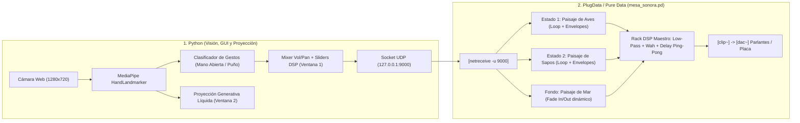

# Mesa Sonora: Control Gestual de 2 Estados + Mixer Vol/Pan + Filtros DSP
**Laboratorio de Sonido 3 — Trabajo Final Integrador: Sonomontaje y Ecología Acústica**

Sistema interactivo de sonomontaje y procesamiento de audio en tiempo real mediante visión artificial por cámara web, comunicación UDP local y síntesis/DSP en **PlugData / Pure Data**.

---

## Inicio Rápido (en cualquier computadora)

### Requisitos previos
1. **Python 3.9 o superior** ([python.org](https://www.python.org/downloads/)).
2. **PlugData** (recomendado: [plugdata.org](https://plugdata.org)) o **Pure Data Vanilla**.
3. **Cámara web** conectada.

### En Windows (instalación en 2 clics)
1. Cloná o descargá este repositorio:
   ```powershell
   git clone https://github.com/krea27/mesa_sonora.pd.git
   cd mesa_sonora.pd
   ```
2. Hacé doble clic en **`instalar.bat`** (crea un entorno virtual `.venv` e instala todas las librerías automáticamente, solo hace falta hacerlo una vez).
3. Hacé doble clic en **`iniciar.bat`** para abrir la aplicación y lanzar PlugData con `mesa_sonora.pd`.

### En macOS / Linux (o desde terminal)
```bash
git clone https://github.com/krea27/mesa_sonora.pd.git
cd mesa_sonora.pd

python3 -m venv .venv
source .venv/bin/activate
pip install -r requirements.txt
```
Luego abrí `mesa_sonora.pd` en **PlugData** y ejecutá:
```bash
python mesa_sonora.py --no-pd
```

---

## 1. Arquitectura del Sistema



---

## 2. Estructura de Archivos

* **`instalar.bat`**: Instalador automático para Windows (crea `.venv` e instala `requirements.txt`).
* **`iniciar.bat`**: Lanzador por doble clic que ejecuta Python (usando `.venv` si existe) e inicia PlugData automáticamente con el patch cargado.
* **`requirements.txt`**: Lista de dependencias de Python (`opencv-python`, `mediapipe`, `numpy`).
* **`mesa_sonora.py`**: Aplicación central en Python (captura de cámara, seguimiento con MediaPipe, interfaz de usuario con OpenCV y simulación de fluidos).
* **`mesa_sonora.pd`**: Patch modular de PlugData / Pure Data con recepción UDP, ruteo de señales, envolventes antirruido y rack de efectos DSP.
* **`hand_landmarker.task`**: Modelo de red neuronal de MediaPipe optimizado para detección y tracking de puntos clave de la mano.
* **`sonidos/`**: Banco de audios estéreo en formato `.wav`:
  * `paisaje-de-aves.wav`: **Estado 1 (Mano Abierta)** — Biofonía diurna, texturas vivaces y agudas. (Vol: 135%, Pan: Centro).
  * `paisaje-de-sapos.wav`: **Estado 2 (Puño Cerrado)** — Biofonía nocturna, frecuencias medias-bajas rítmicas. (Vol: 160%, Pan: Centro).
  * `paisaje-de-mar.wav`: **Pista base constante** — Geofonía envolvente. Fade-In al interactuar, 10s de cola tras retirar la mano y Fade-Out gradual. (Vol: 35%, Pan: Centro).
* **`diagramas/`**:
  * `diagrama_1_python.png`: Diagrama de flujo de visión artificial, interfaz gráfica y proyección.
  * `diagrama_2_plugdata.png`: Diagrama de ruteo de audio, canales y DSP en PlugData.
  * `diagrama_2_pure_data.png`: Copia de referencia del ruteo en Pure Data.
* **Documentación Técnica**:
  * `CARPETA_TECNICA_SONIDO_3.md`: Fundamentación estética (Schafer, Schaeffer, Reactable) y memoria técnica.
  * `GUION_VIDEOS_ETAPA_3.md`: Guion y pauta paso a paso para registro y demostración en video.
  * `PROYECTO_MESA_SONORA.md`: Documento de diseño y especificaciones técnicas.

---

## 3. Paneles de la Interfaz (Ventana 1: Trackeo)

### Panel Izquierdo: Mezclador en Vivo
* **Volumen (0% a 200%)**: Sliders independientes para Aves, Sapos y Mar.
* **Paneo (L100% - C - R100%)**: Ubicación estéreo independiente para cada paisaje sonoro.

### Panel Derecho: Filtros y Procesamiento DSP
* **Low-Pass (120 Hz a 15 kHz)**: Filtro pasa-bajos de doble polo (-12 dB/oct). En frecuencias bajas produce un efecto subacuático/cavernoso; abierto restaura todo el brillo espectral.
* **Wah Resonante (Mix 0-100% | Frecuencia 180 Hz a 3.8 kHz | $Q = 9.0$)**: Barrido resonante muy pronunciado con formante vocal dinámico ("ooo" a "iii").
* **Delay Ping-Pong (Wet 0-100% | Feedback 0-88%)**: Retardo estéreo cruzado (320 ms izquierda / 460 ms derecha) que va desde un rebote sutil hasta ecos cavernosos infinitos.

---

## 4. Guía de Controles (Mouse y Teclado)

| Control | Acción | Descripción |
| :--- | :--- | :--- |
| **Mouse Izquierdo** | Clic y arrastrar | Mover sliders de Volumen, Pan o DSP en tiempo real |
| **Mouse Derecho** | Clic sobre un slider | Resetear ese slider individual a su valor predeterminado |
| **`[R]`** | Teclado | **Reset total**: restablece todos los sliders y apaga/abre filtros DSP |
| **`[F]`** | Teclado | Alternar Low-Pass entre **Slider manual** vs **Control por Mano (Eje X)** |
| **`[W]`** | Teclado | Alternar Wah entre **Slider manual** vs **Control por Mano (Eje Y)** |
| **`[E]`** | Teclado | Alternar Delay entre **Slider manual** vs **Control por Mano (Profundidad Z)** |
| **`[F11]` / `[P]`** | Teclado | **Pantalla Completa** en la ventana de Proyección Líquida |
| **`[V]`** | Teclado | Cambiar **Estilo Visual** (1: Tinta líquida, 2: Plasma orgánico, 3: Ferrofluido) |
| **`[S]`** | Teclado | Activar/desactivar **Silueta difusa** de manos (vidrio esmerilado / sombra sumergida) |
| **`[+]` / `[-]`** | Teclado | Aumentar o disminuir escala de la mano proyectada en vivo ($\pm 10\%$) |
| **`[` / `]`** | Teclado | Disminuir o aumentar el factor de suavizado del trackeo ($\pm 0.05$) |
| **`[M]`** | Teclado | Disparar Fade-In / Fade-Out manual del Paisaje de Mar |
| **`[C]`** | Teclado | **Silenciar todo** en Pure Data y limpiar lienzo visual |
| **`[Q]` / `[ESC]`** | Teclado | Salir de la aplicación y cerrar sesión limpiamente |

---

## 5. Parámetros de Línea de Comandos

```bash
python mesa_sonora.py [--cam CAM] [--port PORT] [--host HOST] [--smooth SMOOTH] [--margin MARGIN] [--no-pd]
```

* `--cam`: Índice de cámara web (por defecto: `0`).
* `--port`: Puerto UDP de destino en PlugData (por defecto: `9000`).
* `--host`: Dirección IP de recepción (por defecto: `127.0.0.1`).
* `--smooth`: Factor de suavizado EMA inicial entre 0.0 y 0.95 (por defecto: `0.70`).
* `--margin`: Margen activo en los bordes de cámara (por defecto: `0.08`).
* `--model`: Ruta personalizada al archivo `hand_landmarker.task`.
* `--no-pd`: No intentar abrir PlugData automáticamente.
